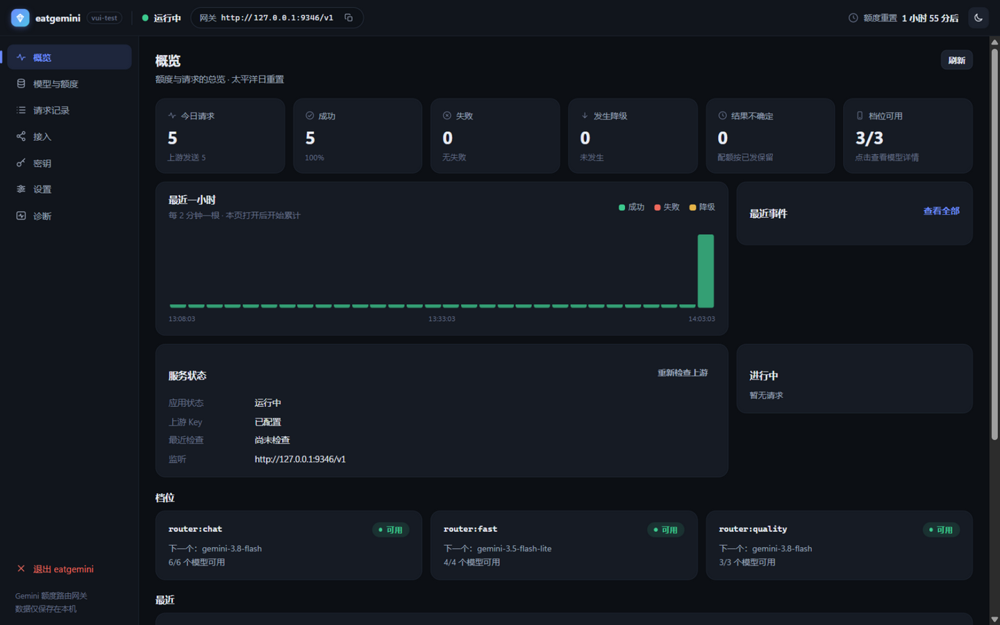
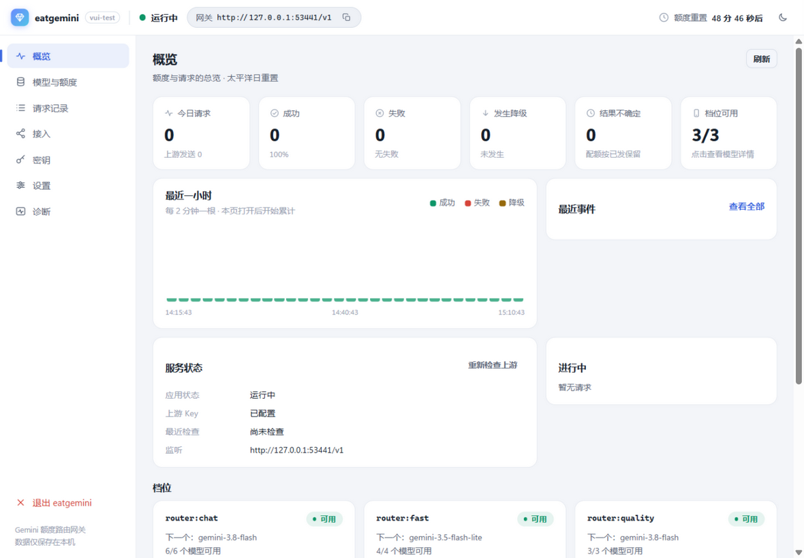
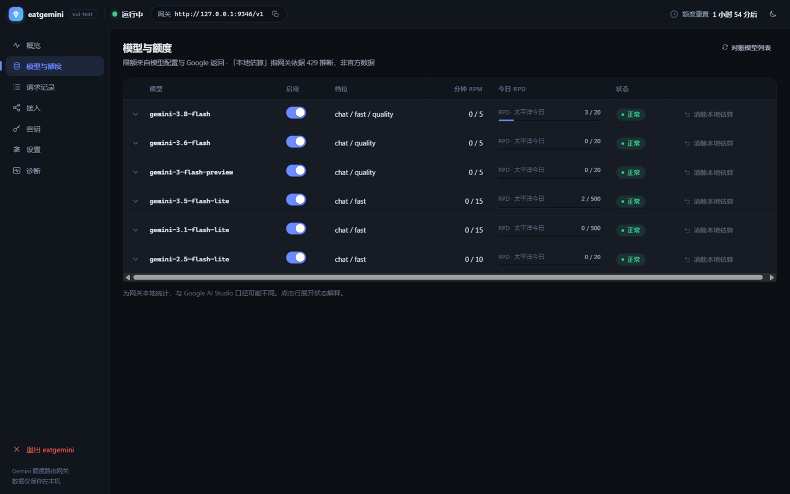
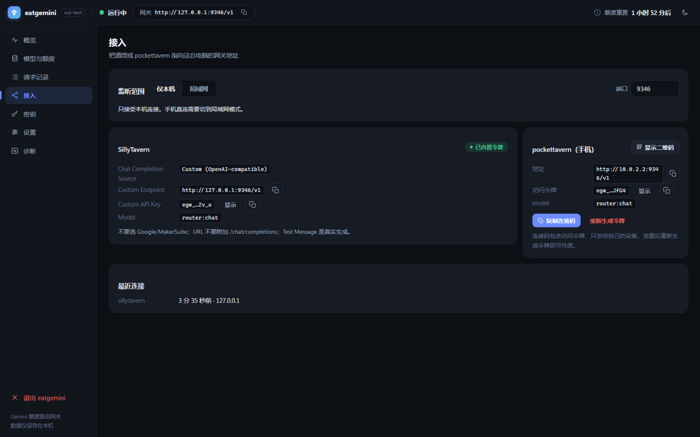

<div align="center">

# eatgemini

**A local, single-file gateway that keeps your SillyTavern chats alive
on the free Gemini models from Google AI Studio.**

One OpenAI-compatible endpoint. Automatic failover when a model's free quota
runs out. Your key never leaves your machine.

[](https://github.com/wacilimonster-source/eatgemini/actions/workflows/ci.yml)
[](https://github.com/wacilimonster-source/eatgemini/releases)
[](LICENSE)

[](README.md)

`eatgemini.exe` portable · single file ｜ `eatgemini-setup-v*.exe` installer · Start Menu / uninstall / autostart / update check

</div>

---

## The problem it solves

Free Gemini models on AI Studio are great — until the one you're using hits its
per-minute or per-day cap mid-roleplay and your chat dies with a 429.

**eatgemini sits between your client and Google.** You point SillyTavern (or
pockettavern on your phone) at one local endpoint, and it routes every request
to the best available free model — falling through an ordered candidate list
whenever a model's RPM/TPM/RPD is exhausted, and switching back when quota
resets.

```text
SillyTavern ──┐
              ├─▶ eatgemini (localhost) ──▶ 1. gemini-2.5-flash        ← RPM cap → skip
pockettavern ─┘        │  quota engine    2. gemini-2.5-flash-lite   ← takes over
                       │                   3. gemini-2.5-pro          ← used for quality
                       └─ Pacific-day reset · 429 cooldowns · low-freq probes
```

## Highlights

| | |
|---|---|
| **Never dead-ends** | Ordered fallback across your free models (`chat` / `fast` / `quality` profiles). A 429 cools the model down instead of killing your request. |
| **Quota-honest** | RPM/TPM sliding windows, per-day RPD with a proper Pacific-time reset, "suspected exhausted" local estimates plus low-frequency probes to re-check. |
| **OpenAI-compatible** | `/v1/chat/completions` with streaming (SSE) and non-streaming. `/v1/models` included. |
| **Two editions** | Portable single exe, or an installer with Start Menu shortcuts, uninstall entry, autostart and update checks. No Docker, Node, Python or runtime in either. |
| **Private by design** | API key encrypted with Windows DPAPI; no chat content ever logged; every diagnostic passes a redaction pipeline. Update checks are off by default and only fetch version metadata. |
| **ToS-friendly** | Uses **your own** free quota — no multi-key pooling, no multi-project rotation, no request amplification. Deliberately. |
| **Real monitoring UI** | Live stats, hourly charts, per-model quota meters, request timeline down to each upstream attempt. |
| **Honest numbers** | Unknown values render as `—`, never invented estimates. |

## Screenshots

| Overview (dark) | Overview (light) |
|---|---|
|  |  |

| Models & quota | Connect |
|---|---|
|  |  |

## Quick start

1. **Download** from the [latest Release](https://github.com/wacilimonster-source/eatgemini/releases/latest) — pick one:
   - **Installer** `eatgemini-setup-v0.2.9.exe`: installs to `%LOCALAPPDATA%\Programs\eatgemini`, adds Start Menu shortcuts and an uninstall entry.
   - **Portable** `eatgemini-v0.2.9.exe`: one file, double-click and run, no install needed (rename to `eatgemini.exe` if you like).
2. **Paste your Google AI Studio key** in the guided 3-step setup (validated first, encrypted locally with DPAPI).
3. **Point your client** at the gateway — the Connect page gives you the exact
   SillyTavern settings and a one-line connect code for pockettavern on your phone.

> Detailed docs (in Chinese): [design spec](docs/产品设计-eatgemini桌面单文件版-2026-11-06.md) ·
> [UX changelog](docs/开发说明-2026-11-06.md) · [UI design system](docs/产品设计-UI视觉与交互规范-2026-11-07.html)

## Installer, autostart & updates

| | Portable | Installer |
|---|---|---|
| Layout | Single `eatgemini.exe` | `eatgemini-setup-vX.Y.Z.exe` → `%LOCALAPPDATA%\Programs\eatgemini` |
| Start Menu / uninstall | — | Yes (HKCU uninstall key, no admin rights) |
| Autostart / update check | Yes | Yes |
| Data directory | Shared `%LOCALAPPDATA%\eatgemini` (key, config, logs) | Same; uninstall keeps it |

**Autostart**: toggle it in Settings → Desktop & updates, or from the tray menu. Off by
default. It writes `HKCU\...\CurrentVersion\Run` and starts with `--minimized` (no
window). If the exe moves or is upgraded, the path is repaired on the next start.
Uninstall removes the entry.

**Update check**: click "Check for updates" (or use the tray), or enable the optional
startup check (off by default, at most once per 24h). The backend reads the latest
GitHub Release, falling back to `update.json` in the repo. No key, token, conversation
or usage data is sent; the UI still talks only to the local console API and loads no
external scripts or fonts. You can skip a version, download the installer and launch
it with one click — the installer asks the running gateway to exit before replacing
the exe, then restarts it. Config and key are preserved.

> **Privacy**: no network traffic for updates by default. GitHub is contacted only
> when you check manually or explicitly enable the automatic check.

## What "dynamic" means here

- **Profile-based routing** — `chat` (auto-fallback), `fast` (latency-first),
  `quality` (best model only). Reorder models inside each profile from the UI; saves hot-reload.
- **Commit boundary** — a request is only "submitted" after the upstream sends a
  valid first completion event; before that, switching models costs the client nothing.
- **Bounded retries** — transient 5xx and parameter-repair retries are capped per request;
  the gateway never amplifies your upstream usage.
- **Reset-aware** — daily caps are tracked against the *Pacific-day* boundary Google uses,
  not your local midnight.

## Build from source

```powershell
# requires Dart SDK 3.x
powershell -ExecutionPolicy Bypass -File tool/build.ps1 -Version 0.2.9
# → build/eatgemini.exe                 portable (GUI subsystem)
#   build/eatgemini-v0.2.9.exe           portable release copy
#   build/eatgemini-setup-v0.2.9.exe     installer (payload = portable exe)
#   build/update.json                    fallback manifest for update checks
# portable only: add -SkipInstaller
```

The installer is plain Dart (`bin/installer.dart`): the build appends the portable exe
to the installer binary as an overlay payload, so no Inno Setup / NSIS is needed.
Pushing a `v*` tag (or a manual CI run) produces all release artifacts.

Or run from source: `dart run bin/eatgemini.dart --data-dir <dir>`.
Run the test suite with `dart test` (173 tests), end-to-end smoke with `dart run tool/e2e_smoke.dart`.

## Roadmap

- [ ] QR-code connect (phone → gateway without typing)
- [ ] One-click end-to-end test message
- [ ] Windows notifications (tray icon already shipped)
- [ ] Daily usage history charts
- [ ] Linux/macOS builds (core is pure Dart; DPAPI is the Windows-only bit)

## FAQ

**Is this against Google's terms?**
It uses your own single AI Studio key and your own free quota. It does not pool keys,
rotate projects, or hide usage from Google — 429s are respected and worked around,
not bypassed. That line is a design red line, enforced in code.

**Does it store my conversations?**
No. The request log keeps metadata only (model, outcome, latency, tokens). There is
no code path that persists message content.

**Does the update check upload anything?**
No. Nothing is fetched for updates by default; a manual check (or the opt-in automatic
check) only requests version metadata from GitHub — no keys, tokens, chats or usage.
The proxy configured under Settings → Upstream is reused if present.

**Why Windows-only?**
The single-exe experience relies on DPAPI for key storage; the installer and autostart
use the Windows registry. The routing engine itself is pure Dart — other platforms are
on the roadmap.

**Does it work with anything OpenAI-compatible?**
Yes — any client that can hit a custom OpenAI-style endpoint (SillyTavern, pockettavern,
scripts, curl).

## License

[MIT](LICENSE)

---

<div align="center">
<sub>Built with Dart. 界面与文档提供中文支持 → <a href="README.md">中文说明</a></sub>
</div>
