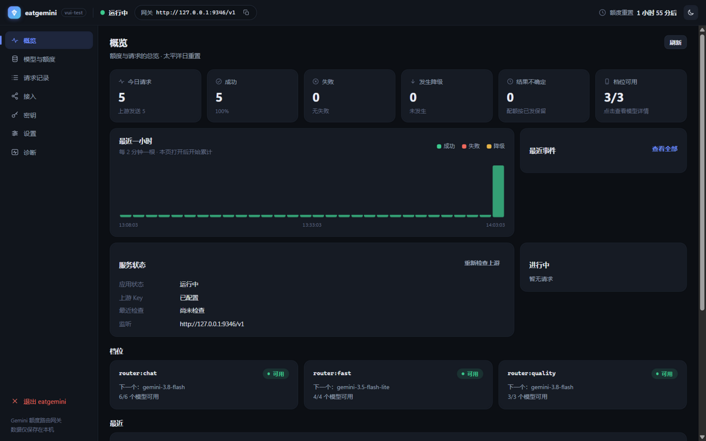
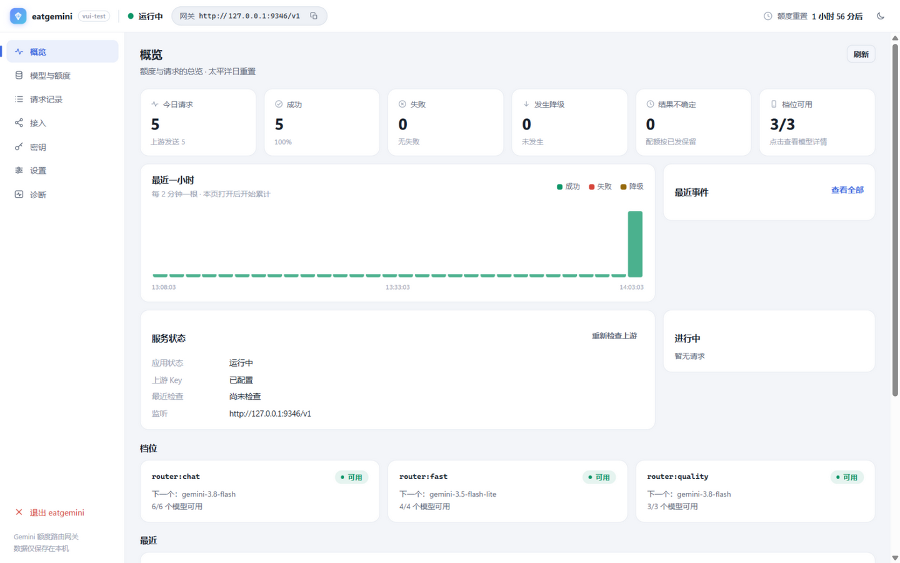
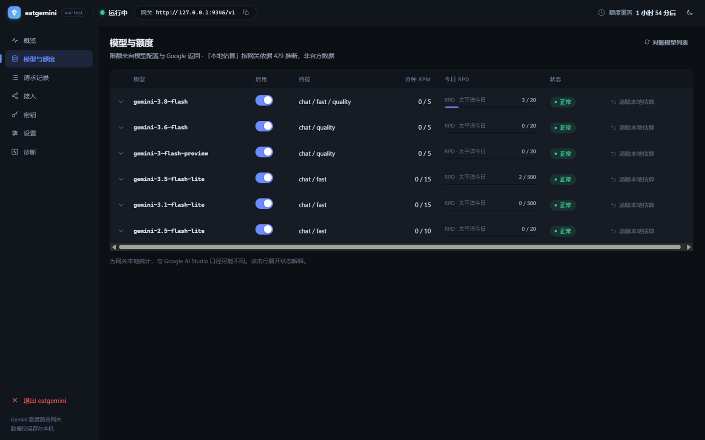
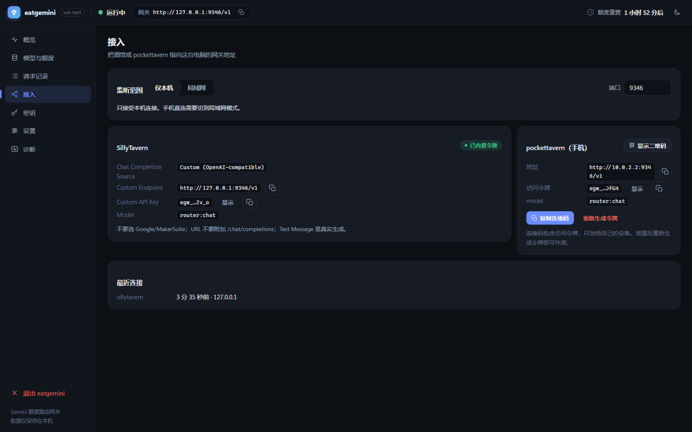

<div align="center">

# eatgemini

**本地单文件网关：让酒馆在 AI Studio 免费 Gemini 额度上永远有模型可用。**

一个 OpenAI 兼容端点。某个模型免费额度用完自动切换下一个。你的 Key 永远不出本机。

[](https://github.com/wacilimonster-source/eatgemini/actions/workflows/ci.yml)
[](https://github.com/wacilimonster-source/eatgemini/releases)
[](LICENSE)

[](README.md)

`eatgemini.exe` · 7.7 MB · 免安装 · 零依赖 · 无控制台窗口

</div>

---

## 它解决什么问题

AI Studio 的免费 Gemini 模型很好用——直到你正在跑的角色扮演撞上 RPM/TPM/RPD 上限，
一条 429 让对话直接断掉。

**eatgemini 挡在你的客户端和 Google 中间。** 酒馆（SillyTavern）或手机
（pockettavern）只管指向一个本地端点，网关把每个请求路由到当前可用的最佳免费模型——
某模型配额耗尽就按序切到下一个，额度恢复后自动切回。

```text
SillyTavern ──┐
              ├─▶ eatgemini（本机）──▶ 1. gemini-2.5-flash        ← RPM 到顶 → 跳过
pockettavern ─┘        │  配额引擎     2. gemini-2.5-flash-lite   ← 顶上
                       │              3. gemini-2.5-pro          ← quality 档专用
                       └─ 太平洋日重置 · 429 冷却 · 低频探测
```

## 核心特性

| | |
|---|---|
| **不断供** | 档位内按序降级（`chat` 自动降级 / `fast` 偏快 / `quality` 只用强模型）；429 触发冷却而不是杀死你的请求 |
| **配额诚实** | RPM/TPM 滑动窗口、RPD 按太平洋日重置（与 Google 同口径）、「疑似用完」本地估算 + 低频探测复核 |
| **OpenAI 兼容** | `/v1/chat/completions` 流式（SSE）与非流式都支持；含 `/v1/models` |
| **零配置** | 单个 7.7 MB exe，无 Docker / Node / Python / 安装器 |
| **隐私优先** | API Key 用 Windows DPAPI 本机加密；对话内容永不落盘；诊断包全链路脱敏 |
| **遵守条款** | 只用**你自己的**免费额度——不做多 Key 轮换、不换项目规避、不放大上游请求，红线写在代码里 |
| **真监控界面** | 实时统计、小时图、逐模型配额仪表、请求可下钻到每一次上游尝试 |
| **数字诚实** | 未知的就显示「—」，绝不编造估算 |

## 截图

| 概览（深色） | 概览（浅色） |
|---|---|
|  |  |

| 模型与额度 | 接入 |
|---|---|
|  |  |

## 三步上手

1. **下载** [eatgemini-v0.2.0.exe](https://github.com/wacilimonster-source/eatgemini/releases/latest)，双击运行
2. **按引导粘贴 AI Studio Key**（先验证有效再保存，DPAPI 本机加密）
3. **客户端接入**——接入页给出 SillyTavern 的准确填法，手机 pockettavern 用一行连接码

> 深入文档：[桌面版设计](docs/产品设计-eatgemini桌面单文件版-2026-11-06.md) ·
> [开发说明](docs/开发说明-2026-11-06.md) · [UI 设计规范](docs/产品设计-UI视觉与交互规范-2026-11-07.html) ·
> [功能优化路线](docs/产品设计-功能体验优化-2026-11-06.md)

## 「动态」体现在哪

- **档位路由**——界面内调整档位里的模型顺序，保存即热加载，下一个请求按新顺序选路
- **提交边界**——上游发出首个合法 completion 事件前不算提交，此前换模型对客户端零成本
- **有界重试**——瞬时 5xx 与参数修复的重试有每请求上限，网关绝不放大你的上游用量
- **重置感知**——日额度按 Google 的太平洋日切，不是你本地的午夜

## 从源码构建

```powershell
# 需要 Dart SDK 3.x
powershell -ExecutionPolicy Bypass -File tool/build.ps1 -Version 0.2.0
# → build/eatgemini.exe（构建脚本自带测试与发布校验）
```

开发运行：`dart run bin/eatgemini.dart --data-dir <目录>`；
测试：`dart test`（101 用例）；端到端冒烟：`dart run tool/e2e_smoke.dart`；
界面手动调试：`dart run tool/ui_harness.dart`。

## 路线图

- [ ] 扫码连接（手机免手输）
- [ ] 一键端到端测试消息
- [ ] 托盘图标 + Windows 通知
- [ ] 每日用量历史图表
- [ ] Linux/macOS 构建（选路内核是纯 Dart，仅 DPAPI 是 Windows 专属）

## 常见问题

**这违反 Google 条款吗？**
只用你自己的一个 AI Studio Key、你自己的免费额度。不池化 Key、不轮换项目、不向 Google 隐藏用量——
429 是被尊重并绕行的，不是被对抗的。这条红线写进了代码（引擎直接拒绝多项目配置）。

**会存我的对话吗？**
不会。请求记录只有元数据（模型/结果/耗时/Token），不存在任何持久化消息正文的代码路径。

**为什么只有 Windows？**
单文件体验依赖 DPAPI 存 Key。选路内核是纯 Dart，其他平台在路线图上。

**OpenAI 兼容的客户端都能用吗？**
能。任何支持自定义 OpenAI 端点的客户端都行（SillyTavern、pockettavern、脚本、curl）。

## 许可

[MIT](LICENSE)

---

<div align="center">
<sub>用 Dart 构建 · English docs → <a href="README.md">README</a></sub>
</div>
